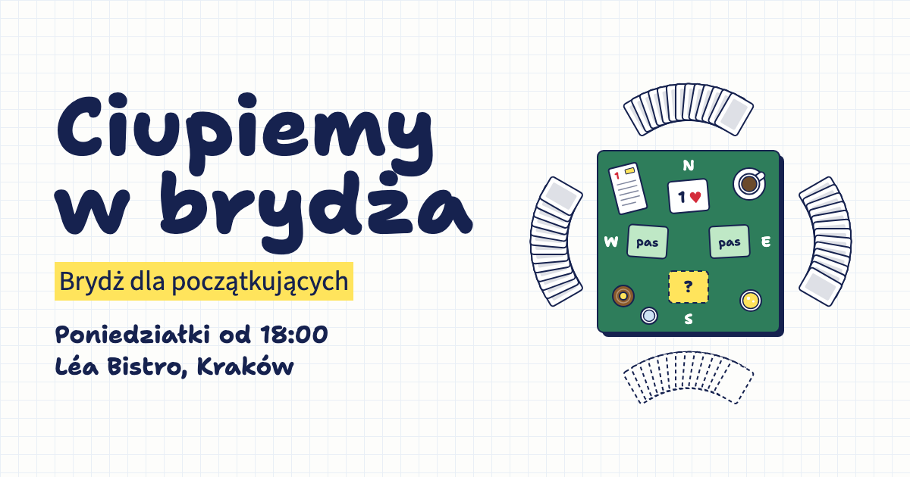

# Ciupiemy w brydża

Strona i ściągawki krakowskiego klubu brydżowego **Ciupiemy w brydża**. Gramy i uczymy się brydża
w poniedziałki od 18:00 w Léa Bistro, ul. Juliusza Lea 11b, Kraków. Początkujący mile widziani.

**[ciupiemy.pl](https://ciupiemy.pl/)** · [System licytacji](https://ciupiemy.pl/system/) · [Karty do druku (PDF)](https://ciupiemy.pl/karty/karty-do-druku.pdf)

[](https://ciupiemy.pl/)

> **In English:** website and bidding cheat sheets of a beginner-friendly bridge club in Kraków, Poland.
> One Python file holds the bidding system; a small build script turns it into phone-sized cards (PNG),
> a printable PDF and a static site. Content is in Polish. Feel free to reuse it for your own club.

## Co tu jest

- **Strona klubu**: kiedy i gdzie gramy, jak wygląda gra z początkującymi, polecane aplikacje.
- **System licytacji**: naturalny, pięciokartowe starsze, najbliżej SAYC. Opis i uzasadnienie w [SYSTEM.md](SYSTEM.md).
- **Ściągawki**: cztery karty w formacie ekranu telefonu (PNG 1080 × 1920), paczka ZIP i PDF do druku.

Wszystko powstaje z jednego pliku z treścią, więc karty, PDF i strona nigdy się ze sobą nie rozjeżdżają.

## Układ repozytorium

```
build/                  generator: tu się wszystko zmienia
  content.py            treść kart i systemu, jedyne źródło prawdy; także adres strony (SITE_URL)
  build.py              buduje karty PNG, ZIP, PDF, stronę i obrazek podglądu linku
  components.css        wspólny wygląd paneli i kafelków odzywek
  card.css              rama karty 9:16 i motyw do druku
  site.css              wygląd strony
  templates/            szablony strony głównej i strony systemu
  fonts/                Shantell Sans, Source Sans 3, symbole kolorów z DejaVu Sans (z licencjami)
docs/                   gotowa strona; GitHub Pages serwuje ten folder (nie edytuj ręcznie)
SYSTEM.md               pełny opis systemu, historia poprawek i otwarte pytania
zrodla/                 zdjęcia odręcznych karteczek, od których wszystko się zaczęło
```

## Jak zbudować

Potrzebny jest Python 3.10+ i Chromium, które instaluje Playwright.

```bash
python -m venv .venv && source .venv/bin/activate
pip install -r build/requirements.txt
playwright install chromium          # tylko za pierwszym razem
python build/build.py
python -m http.server -d docs 8000   # podgląd: http://localhost:8000
```

Inna przeglądarka: `CHROME_PATH=/ścieżka/do/chrome python build/build.py`.

## Jak zmienić system albo stronę

1. Treść kart i systemu popraw w `build/content.py` (składnia jest opisana na górze pliku),
   teksty strony w `build/templates/`, wygląd w plikach CSS.
2. Uruchom `python build/build.py`. Gdy tekst nie zmieści się na karcie, skrypt wypisze
   `UWAGA: treść się nie mieści!`. To błąd: skróć tekst.
3. Obejrzyj stronę lokalnie, zatwierdź źródła razem z `docs/` i wypchnij. Strona odświeży się po minucie lub dwóch.

## Druk

`docs/karty/karty-do-druku.pdf` to jedna kartka A4 pionowo z czterema kartami na białym tle.
Drukuj w skali 100% („Rzeczywisty rozmiar”), nie „Dopasuj do strony”, i wytnij po przerywanej linii.
Karta ma ok. 7,5 × 13,5 cm i dobrze wygląda zalaminowana.

## Hosting

Strona działa na GitHub Pages z gałęzi `main`, folder `/docs`, pod własną domeną `ciupiemy.pl`.

- Adres strony jest w `SITE_URL` w `build/content.py`. Budowanie tworzy z niego `docs/CNAME`
  i adresy w podglądzie linku (`docs/assets/og.png`, znaczniki Open Graph).
- DNS domeny: cztery rekordy A na adresy GitHub Pages (`185.199.108.153`, `185.199.109.153`,
  `185.199.110.153`, `185.199.111.153`) oraz CNAME `www` na `witekbobrowski.github.io`.
  Aktualne adresy są w [dokumentacji GitHub Pages](https://docs.github.com/en/pages/configuring-a-custom-domain-for-your-github-pages-site).

## Chcesz użyć tego w swoim klubie?

Śmiało. Zrób fork, podmień treść w `build/content.py` i teksty w `build/templates/`, ustaw swój
`SITE_URL` i zbuduj. Prosimy tylko o podanie źródła (szczegóły niżej).

## Jak pomóc

Zauważone błędy i pomysły zgłaszaj w [issues](https://github.com/witekbobrowski/ciupiemy-w-brydza/issues).
Zasady dla poprawek są w [CONTRIBUTING.md](CONTRIBUTING.md).

## Licencja

- Kod generatora: [MIT](LICENSE).
- Treść (opis systemu, teksty, karty, ilustracje, zdjęcia): [CC BY 4.0](LICENSE-CONTENT.md).
- Kroje pisma w `build/fonts/` mają własne licencje, dołączone obok plików.
